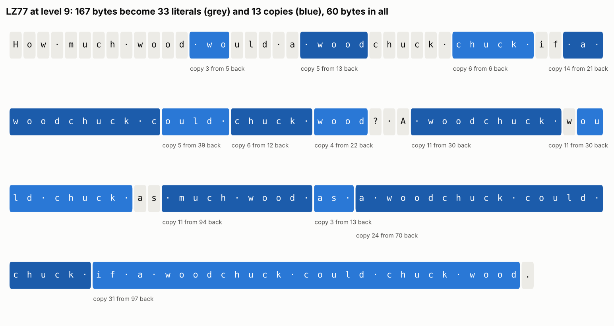
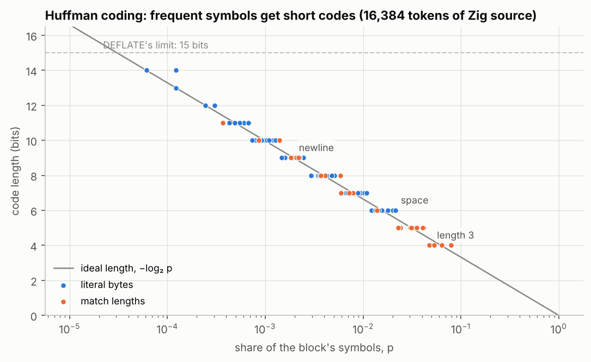
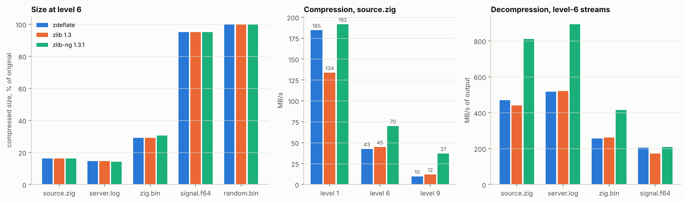

# zig-deflate

DEFLATE compression and decompression in Zig, written from the RFCs: raw DEFLATE (RFC 1951) and the zlib (RFC 1950) and gzip (RFC 1952) formats around it. It uses nothing from Zig's own `std.compress`.

The compressor uses the same parser and settings as zlib's levels 1 to 9, and on the benchmark files its output is never larger than zlib's. The decompressor was run with zlib on 20,000 damaged streams, and the two agree on every one about what to accept and what to reject.



DEFLATE works in two steps. First, LZ77 replaces repeated text with copies of earlier text ("copy 14 bytes from 21 back"). Then Huffman coding gives frequent symbols short codes (figure below). The 167 bytes of this tongue twister become 33 literals and 13 copies, 60 bytes in all.

## Results

| Claim | Evidence | Grade |
|---|---|---|
| Works with other implementations in both directions | 315 round trips on the first MiB of each corpus file. zdeflate's output at every level, 0 to 9, is decoded by classic zlib 1.3 and zlib-ng 1.3.1 (raw) and by Python's gzip module and GNU gzip 1.12 (gzip). zdeflate decodes zlib's and zlib-ng's output at levels 1, 6 and 9 with all five zlib strategies, and GNU gzip's | proven by test (runs in CI) |
| The decoder accepts exactly what zlib accepts | 20,000 damaged or random streams. zdeflate, zlib 1.3 and zlib-ng 1.3.1 agree on every one: accept or reject, and for accepted streams the output and where the stream ends. zdeflate is bounds-checked (ReleaseSafe) for this run, so an out-of-bounds read would abort | proven by test (runs in CI) |
| Output size matches classic zlib's | Never larger than zlib 1.3's output, on 5 files at levels 1, 6 and 9. Smaller by 0.002% to 0.08% on the compressible files, equal on random data | measured |
| Speed is close to classic zlib's | On text and machine code, compression is 1.3 to 1.4 times faster at level 1, 5 to 9% slower at level 6 and about 20% slower at level 9. Decompression is between 10% slower and 7% faster | measured, one machine |
| zlib-ng is faster | 1.6 to 1.9 times faster than zdeflate at decompressing text and machine code; 1.6 to 2 times faster at compressing at level 6, and 2 to 4 times at level 9 | measured, one machine |

## How it works

### Decompression

- **Bit reader.** A 64-bit buffer, refilled eight bytes at a time with one unaligned load. The bits above the counted ones are the next input bits, or zeros past the end of the input. So a Huffman lookup can always peek 15 bits, and it checks afterwards whether the code it found was really all there.
- **Huffman tables.** One table per code, indexed by the next 15 bits or fewer. Each entry holds a symbol and its code length. zlib uses two-level tables to keep them small; one level is simpler, at a cost of up to 64 KB per table.
- **Blocks.** Stored, fixed-code and dynamic-code blocks. A copy that does not overlap its own output is one block move; an overlapping copy (a run, such as distance 1) goes byte by byte.
- **What is rejected**, as in zlib:
  - codes with too many symbols for their lengths (over-subscribed);
  - incomplete codes, except a single one-bit code, which RFC 1951 allows for distances and zlib also allows for literals;
  - a repeat of the previous code length when there is none, and code lengths that run past the end of the table;
  - a literal/length code without an end-of-block symbol;
  - copies that reach back before the start of the output;
  - symbols 286, 287, 30 and 31, which take part in the fixed codes but must never appear;
  - block type 3, stored blocks whose length check fails, and headers that declare more than 286 literal/length or 30 distance codes.

### Compression

- **Matching.** Hash chains over 3-byte strings, with zlib's 15-bit hash. The input is in memory, so positions are plain 32-bit offsets and the window never has to slide.
- **Levels.** zlib's table of settings for levels 1 to 9: when to stop searching for a match, and how far to follow a chain. Levels 1 to 3 take the longest match at each position (greedy). Levels 4 to 9 are lazy: a match is kept only if the next position does not start a longer one. In the lazy levels, as in zlib, a 3-byte match more than 4,096 bytes back is dropped, because it usually costs more than three literals. Level 0 writes stored blocks only.
- **Blocks.** Up to 16,384 tokens each. Every block is written in whichever of its three encodings is smallest: stored, the fixed code, or a dynamic code of its own. The choice uses the exact size in bits.
- **Huffman code lengths.** Huffman's algorithm, built with two queues (sorted leaves and merged nodes) instead of a heap. DEFLATE limits codes to 15 bits, and the code that sends the code lengths to 7. Lengths over the limit are cut to it, which over-fills the code, and the code is then repaired as zlib does. Each step moves a leaf one level down and moves a leaf up from the limit to become its sibling, until the Kraft sum is exactly 1 again. The code lengths themselves are sent run-length coded (symbols 16, 17 and 18).



In one block of Zig source, every code length sits close to the line −log₂ p: a symbol that makes up about 1/16 of the block gets a 4-bit code. None reached the 15-bit limit here; the tests build deep trees on purpose to exercise it.

### Containers

- **zlib.** A header with the level hint and check bits exactly as zlib writes them, and an Adler-32 trailer. The decoder checks the header and the checksum, and rejects streams that need a preset dictionary.
- **gzip.** A header with no name or timestamp, and CRC-32 and length trailers. The decoder reads the optional extra, name, comment and header-CRC fields, and accepts several members in a row and zero padding after them.

## Speed and size



The corpus is five 4 MiB files that `scripts/corpus.py` rebuilds exactly:

- `source.zig`: the Zig 0.17.1 standard library's sources;
- `server.log`: a synthetic web server access log;
- `zig.bin`: the start of the Zig 0.17.1 compiler executable (machine code);
- `signal.f64`: float64 samples of a noisy damped oscillation;
- `random.bin`: random bytes.

Size as a percentage of the original, at level 1 / 6 / 9:

| file | zdeflate | zlib 1.3 | zlib-ng 1.3.1 |
|---|---|---|---|
| source.zig | 20.71 / 16.20 / 15.96 | 20.72 / 16.21 / 15.97 | 19.56 / 16.20 / 16.00 |
| server.log | 19.41 / 14.54 / 13.90 | 19.42 / 14.55 / 13.91 | 17.83 / 14.28 / 14.22 |
| zig.bin | 33.18 / 29.08 / 28.97 | 33.18 / 29.10 / 28.98 | 33.38 / 30.51 / 29.02 |
| signal.f64 | 95.52 / 95.05 / 95.05 | 95.52 / 95.05 / 95.05 | 95.01 / 95.01 / 95.48 |
| random.bin | 100.03 for all three levels | 100.03 | 100.03 |

Speed in MB/s on `source.zig`, compression at level 1 / 6 / 9, then decompression of the level-6 stream:

| | compression | decompression |
|---|---|---|
| zdeflate | 185 / 43 / 9.6 | 470 |
| zlib 1.3 | 134 / 45 / 12.1 | 441 |
| zlib-ng 1.3.1 | 192 / 70 / 37 | 812 |

The full table is in `docs/data/bench.csv`.

The benchmark ran on a cloud virtual machine (Intel Xeon at 2.1 GHz, 2 vCPUs, Ubuntu 24.04), single-threaded, on raw DEFLATE. Every speed is the best of three passes over the whole benchmark, and each pass takes the best of at least three runs. zdeflate was built with `-Doptimize=ReleaseFast`. Both zlib libraries were called through ctypes on the same buffers. What the numbers say:

- **Same algorithm, same size.** zdeflate's output is within 0.1% of zlib's, and never larger. The remaining difference comes from block boundaries and from how each block's encoding is chosen; it has not been traced further.
- **Level 1 is faster than zlib.** Two likely reasons: the input is never copied to slide a window, and matches are compared eight bytes at a time. This is plausible, not profiled.
- **Level 9 is about 20% slower.** Nearly all the time goes into following hash chains. zdeflate's chains hold 32-bit positions where zlib's hold 16-bit ones, so they need twice the cache. Also plausible, not profiled.
- **zlib-ng** is a faster fork of zlib. Its sizes differ from zlib's, so it also makes different choices at some levels: its level 1 is 6% to 8% smaller on text, and its level 6 is 5% larger on machine code.
- On a shared virtual machine, speeds wander by several per cent from run to run, so differences smaller than about 10% should not be read as real.

## Use

```sh
zig build -Doptimize=ReleaseFast           # Zig 0.17.1
zig-out/bin/zdeflate -9 < notes.txt > notes.txt.gz
zig-out/bin/zdeflate -d < notes.txt.gz > notes.txt
zig-out/bin/zdeflate -f zlib -6 < data > data.zz     # -f raw|zlib|gzip, default gzip
```

As a library, the module is `deflate`:

```zig
const deflate = @import("deflate");

const packed_data = try deflate.compress(gpa, data, .gzip, 6, null);
defer gpa.free(packed_data);
const back = try deflate.decompress(gpa, packed_data, .gzip);
defer gpa.free(back);
```

## Tests

`zig build test` runs 20 unit tests:

- checksums against known values and against the standard library;
- canonical codes against RFC 1951's worked example;
- Huffman lengths that are optimal when no limit applies and complete when it does, over 300 random alphabets;
- streams made by hand and by zlib, and malformed ones: a bad block type, a stored length that fails its check, truncation, a copy from before the start, over-subscribed and incomplete codes;
- zlib header bytes identical to zlib's at every level;
- gzip members with every optional header field;
- round trips of four kinds of data, at lengths from 0 to 200,000 bytes, at every level in raw DEFLATE and at levels 0, 3, 6 and 9 in zlib and gzip;
- every truncation of a valid stream rejected;
- 3,000 randomly corrupted streams decoded without a crash.

`scripts/interop.py` adds the round trips and the differential test. Its 20,000 streams come from slices of the corpus compressed by zdeflate (levels 0, 1, 6, 9) or zlib (levels 1, 6, 9, every strategy), then damaged:

| damage | streams | all three accept | all three reject | disagree |
|---|---:|---:|---:|---:|
| 1 to 3 bits flipped | 3,340 | 2,039 | 1,301 | 0 |
| one byte overwritten | 3,367 | 1,910 | 1,457 | 0 |
| one byte inserted | 3,381 | 2,319 | 1,062 | 0 |
| truncated | 3,238 | 293 | 2,945 | 0 |
| junk appended | 3,373 | 3,373 | 0 | 0 |
| replaced by random bytes | 3,301 | 21 | 3,280 | 0 |

Damaged streams are often still valid: a flipped bit inside a literal changes the output but not the structure. "Accept" therefore also means the same output and the same stream length from all three decoders. zdeflate's rejections hit all ten of its format errors.

CI runs the unit tests in Debug and ReleaseSafe builds. It also runs the interoperability and differential tests of `scripts/interop.py` on Ubuntu, against classic zlib and GNU gzip; zlib-ng was also present for the runs reported here.

```sh
zig build test
python3 scripts/corpus.py && python3 scripts/interop.py
python3 scripts/bench.py && python3 scripts/figures.py
```

## Limits

- Everything happens in memory: there is no streaming interface, and inputs are limited to 4 GiB.
- No preset dictionaries, no flush points, and one thread.
- Decompression is plain Zig, with no SIMD; zlib-ng is close to twice as fast.

## References

- [RFC 1950](https://www.rfc-editor.org/rfc/rfc1950) (zlib), [RFC 1951](https://www.rfc-editor.org/rfc/rfc1951) (DEFLATE) and [RFC 1952](https://www.rfc-editor.org/rfc/rfc1952) (gzip).
- zlib's `deflate.c` and `trees.c` for the level settings, the lazy-matching rules and the code-length limiting; `inftrees.c` for which incomplete codes are accepted.

## License

Copyright (c) 2026 Ankit Pawar. All Rights Reserved.

This repository is public so that the work can be read and evaluated, but it is not open source. Using, copying, modifying, redistributing or commercially exploiting any part of it requires prior written permission. This does not affect what applicable law allows without permission, or viewing and forking the repository on GitHub under GitHub's Terms of Service. The full terms are in [LICENSE](LICENSE).

Commits up to and including `eab706c` were released under the MIT License, and copies obtained under those terms keep them.

For licensing or collaboration, email ankitpawar0007x@gmail.com or visit [ankitinorbit.com](https://ankitinorbit.com).
